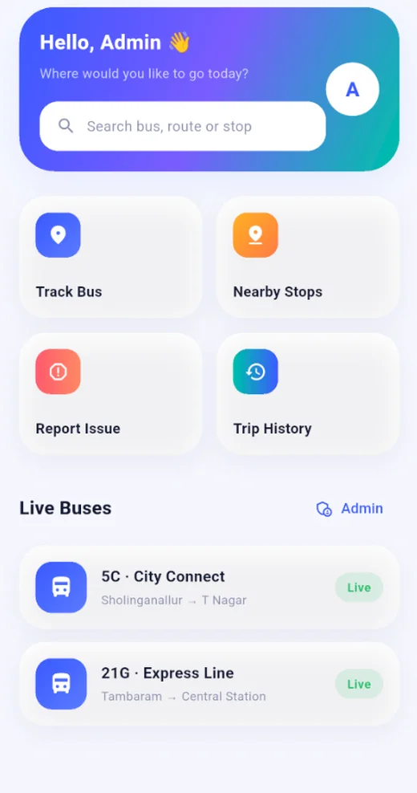
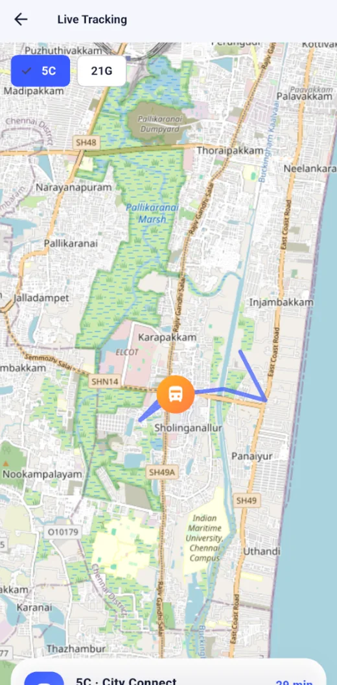
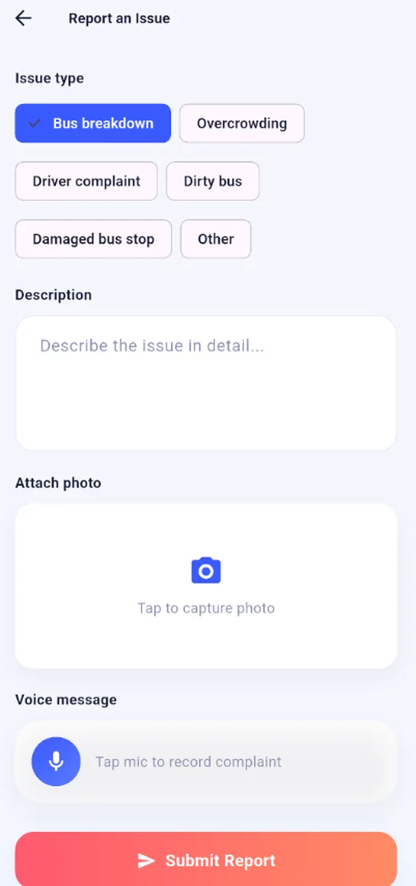

# Live Bus Tracking System


A Flutter prototype for **tracking city buses on a map**. Riders can search buses, routes and stops, find nearby stops by GPS, see a bus move live (simulated), review their trip history and report issues with a photo or voice message. An admin module manages buses, routes and passenger reports. Built during a one-month mobile app development internship at **Zeptoware System Private Limited, Chennai**.

<p align="center">
  
  
  
</p>

## Features

**For passengers**

- Register, log in and reset a password.
- Search buses by number, route or stop.
- **Live tracking:** the selected bus moves along its route on an OpenStreetMap map.
- **Nearby stops** sorted by distance from your GPS location.
- **Report an issue** with a category, description, camera photo and voice message.
- Trip history and profile management.

**For admins**

- Admin dashboard.
- Manage buses and routes.
- View passenger reports, including the attached photos and voice messages.

**Offline first:** all data is stored locally in SQLite, so the app runs without a backend.

## Tech stack

| Area | Packages |
| --- | --- |
| Framework | Flutter, Dart (SDK 3.3 or newer) |
| State | `provider` |
| Database | `sqflite`, `path_provider`, `shared_preferences` |
| Maps and location | `flutter_map` (OpenStreetMap tiles, no API key), `latlong2`, `geolocator` |
| Camera and audio | `image_picker`, `record`, `audioplayers`, `permission_handler` |
| UI | `google_fonts`, `fl_chart`, `shimmer`, `lottie`, `animations`, `flutter_svg` |

## Project structure

```
lib/
├── main.dart                       # App entry point
├── theme/                          # Colors, gradients and typography
├── models/models.dart              # User, Bus, Route, Stop, Report, TripHistory
├── db/db_helper.dart               # SQLite schema and CRUD
├── providers/session_provider.dart # Login and session state
├── widgets/                        # Reusable buttons, cards and fields
└── screens/
    ├── auth/                       # splash, login, register, forgot password
    ├── home/                       # dashboard, search, live tracking, nearby
    │                               # stops, report issue, trip history, profile
    └── admin/                      # dashboard, buses, routes, reports
```

## Getting started

### Prerequisites

- [Flutter SDK](https://docs.flutter.dev/get-started/install) (Dart 3.3 or newer)
- Android Studio with the Flutter and Dart plugins, plus an emulator or an Android phone

### Run it

```bash
git clone https://github.com/Shahith645/Live-Bus-Tracking.git
cd Live-Bus-Tracking
mkdir -p assets/images        # the pubspec lists this folder, so it must exist
flutter pub get
flutter run
```

On Windows PowerShell use `mkdir assets\images`.

### Android permissions

The app needs camera, microphone, location, internet and storage permissions. They are already listed in `android_manifest_permissions.xml`. If a feature is blocked, make sure those entries are present in `android/app/src/main/AndroidManifest.xml`.

### Build an APK

```bash
flutter build apk --release
```

The APK is created in `build/app/outputs/flutter-apk/`.

## Demo login

- **Admin:** `admin@bus.com` / `admin123` (opens the Admin Dashboard from Home). This account is seeded in the local database for the prototype only.
- Or tap **Register** to create a passenger account.

Demo buses and routes are added automatically on first launch, for example `Tambaram → Central Station` on bus **21G** and `Sholinganallur → T Nagar` on bus **5C**.

## How the live tracking works

There is no real GPS feed from a driver app. The selected bus "moves" along a generated polyline every 3 seconds using a `Timer`, and its position is written to its SQLite row (`lastLat` and `lastLng`). This keeps the demo fully offline.

## Roadmap

- Firebase Auth and Firestore for multi-device sync.
- A driver app that broadcasts real GPS positions in place of the simulation.
- QR ticketing and push notifications.

## Author

**Shahith S**, final-year CSE student at University College of Engineering, Nagercoil
[GitHub](https://github.com/Shahith645) · [LinkedIn](https://www.linkedin.com/in/shahith-s/)
